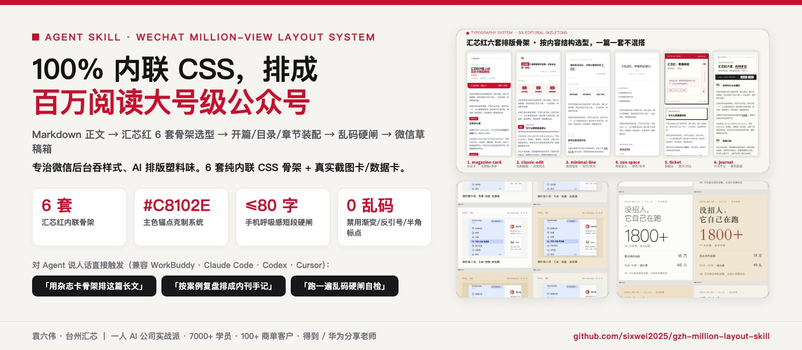
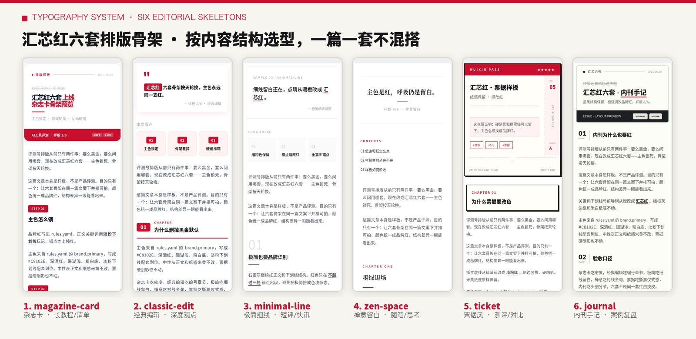
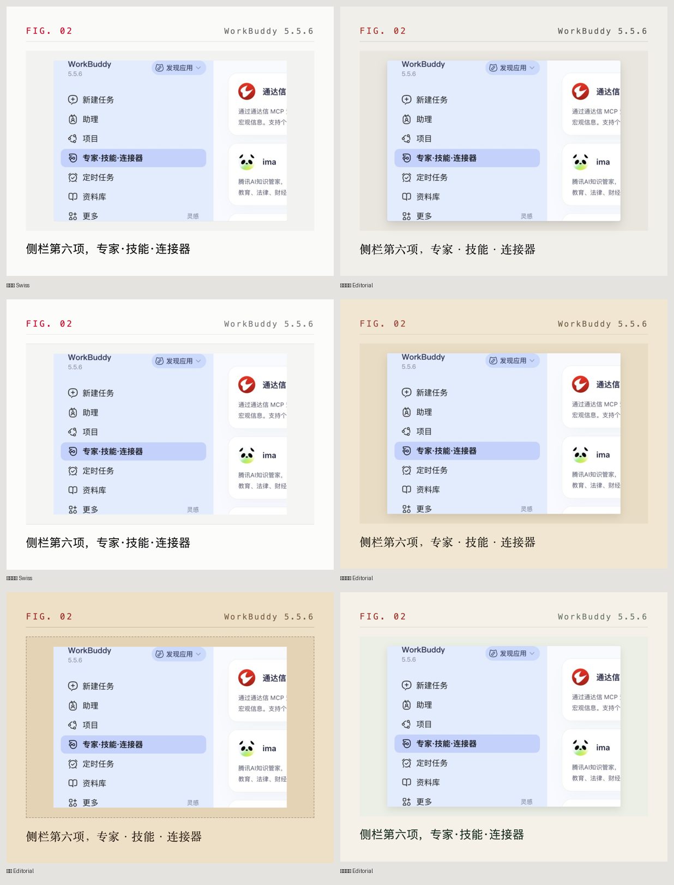
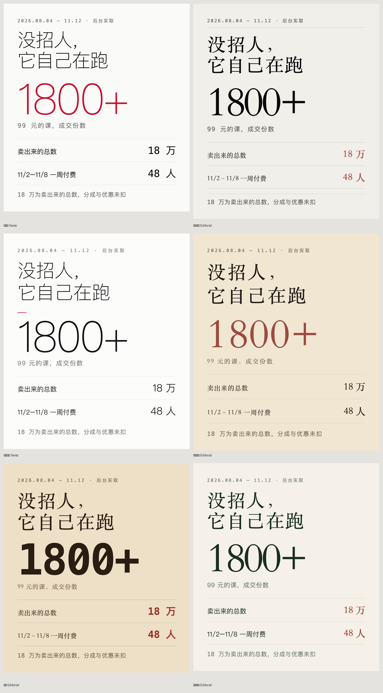
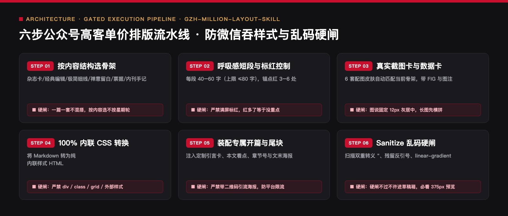

<div align="center">



# 公众号百万级排版 Skill
### `gzh-million-layout-skill` · 汇芯红 `#C8102E` 六套内联 CSS 骨架 + 配图皮肤 + 乱码硬闸

[](https://agentskills.io)
[](#二汇芯红六套排版骨架按内容结构选型)
[](#三正文配图皮肤真实截图卡--结构化数据卡)
[](LICENSE)

> 🔴 **作者：袁六伟 · 台州汇芯**｜一人 AI 公司创业者，学员 7000+，客户 100+，得到 / 华为分享老师  
> 📮 更多 AI 工具实测与自动化实战，关注 **公众号 / 视频号：袁六伟**

**写文两小时，微信后台调格式一小时——这是内容创作者最大的心流杀手。**  
本 Skill 将百万阅读大号的版式控制力封装成 **6 套汇芯红 `#C8102E` 纯内联 CSS 骨架**，自带开篇引言卡、滑动章节看点、真 HTML 横滑表格、6 套配图皮肤与推送前 `sanitize` 乱码硬闸。复制粘贴或 API 推入微信草稿箱**零丢样式、深色模式不崩**。

```bash
# 一键安装 Skill
npx skills add sixwei2025/gzh-million-layout-skill

# 跑一遍推送前乱码与微信兼容性硬闸
python3 skills/公众号百万级排版skill/scripts/gzh_design_sanitize.py article.html --write
```

[为什么微信后台总吞样式](#一为什么普通排版进了微信后台就变塑料味) · [六套排版骨架](#二汇芯红六套排版骨架按内容结构选型) · [截图卡与数据卡](#三正文配图皮肤真实截图卡--结构化数据卡) · [六步排版流水线](#四六步排版与乱码硬闸流水线) · [安装与改造](#五快速安装与品牌色改造)

</div>

---

## 一、为什么普通排版进了微信后台就变「塑料味」？

微信公众号后台有一个极其严苛的 HTML 过滤器：它会剥离外部 `<style>`、吞掉 `class` 和 `id`、过滤 `display: grid` 和 CSS 变量 `var(--x)`，甚至连复杂渐变都会在部分机型上渲染成刺眼的色块。

本仓库用三层工程约束解决「好看且能发出去」的问题：
1. **视觉克制纪律（一套只用一个锚点色）**：全文统一使用汇芯红 `#C8102E` 作为唯一品牌锚点色，金句标红严格控制在 **3–6 处**（满屏标红等于没有重点）。
2. **手机 375px 视口呼吸感**：正文 15–16px，行高 1.75–1.85，每段严格控制在 **40–60 字（硬上限 ≤80 字）**，彻底告别密不透风的文字墙。
3. **100% `<section>` 内联样式 + 乱码硬闸**：所有组件编译为微信原生支持的纯内联 CSS，并在推箱前通过 `gzh_design_sanitize.py` 拦截 `&amp;quot;` 双重转义、残留反引号、半角标点与禁用标签。

---

## 二、汇芯红六套排版骨架（按内容结构选型）

<p align="center">
  
</p>

| 骨架 ID | 风格名称 | 视觉结构特征 | 选型指南（按文章结构选，不硬套日历） |
| :--- | :--- | :--- | :--- |
| `magazine-card` | **杂志卡** | 顶栏期号红标 + 滑动章节导览卡 + `STEP 01` 红底胶囊 | **长篇保姆级教程 / 多步骤实操 / 清单体**（最吃信息密度） |
| `classic-edit` | **经典编辑** | 双引号定制引言卡 + 三宫格本文看点 + `01 CHAPTER` 粗红线 | **深度商业观点 / 行业拆解 / 认知破局**（最显论证层次） |
| `minimal-line` | **极简细线** | 超大浅灰数字编号 + 1px 细线留白 + 极少红锚点 | **短评快讯 / 轻量观点 / 每日速递**（最重呼吸感） |
| `zen-space` | **禅意留白** | 居中衬线宋体标题 + 极简章节分割线 + 宽行距 | **创业心法 / 个人随笔 / 深度思考**（最显克制与定力） |
| `ticket` | **票据风** | `HUIXIN PASS` 撕票虚线头图 + 硬阴影边框章节盒 | **工具横评 / 方案对比 / 选型打分表**（最具仪式感） |
| `journal` | **内刊手记** | 黑底白字期号条 + 左侧竖排 `01 PART` 编号 + 灰框结语 | **项目复盘 / 实战案例 / 内部方法论**（最具档案感） |

---

## 三、正文配图皮肤：真实截图卡 + 结构化数据卡

好排版不仅管文字，更要管配图怎么融入版心。配套的 6 套配图皮肤会自动跟随当前骨架换肤：

> **① 真实实操截图卡（6 套皮肤）** — 自动加上 `FIG` 编号、软件版本标、边框阴影与 12px 居中灰图注，让读者一眼看出「真跑过」：

<p align="center">
  
</p>

> **② 结构化数据卡（6 套皮肤）** — 当遇到算账对比、核心八条原则等无界面可截的抽象关系时，直接渲染为高对比度数据卡：

<p align="center">
  
</p>

---

## 四、六步排版与乱码硬闸流水线

<p align="center">
  
</p>

### 推箱前必过硬闸（`references/乱码硬闸与检查清单.md`）

| 检查项 | 拦截标准 | 自动处置方式 |
| :--- | :--- | :--- |
| **双重转义与反引号** | 正文出现 `&quot;`、`&amp;quot;` 或未转换的 `` `code` `` | `gzh_design_sanitize.py --write` 自动修复或报错阻断 |
| **禁用 CSS 属性** | `linear-gradient`、`display:grid`、`position:fixed`、`<div>` | 强制降级为微信支持的纯色背景与 `<section>` 弹性盒 |
| **图注与表格规范** | 图注误用 15px 正文字号；长图未横拼连续刷屏；假表格 | 图注锁定 `12px #9CA3AF 居中`；表格真 `<table>` + `overflow-x:auto` |
| **文末组件顺序** | 签名重复出现、海报带灰框或含违规引流二维码 | 固定顺序：`666 CTA 色块` → `无框业务介绍海报` → `唯一作者签名` |

---

## 五、快速安装与品牌色改造

```bash
# 1. 一键安装到 Agent
npx skills add sixwei2025/gzh-million-layout-skill

# 2. 对 Agent 说人话即可排版
# 「用公众号百万级排版skill，把这篇 Markdown 按杂志卡骨架排成公众号 HTML，过一遍乱码硬闸」
```

### 3 步改成你自己的品牌色
1. 打开 `skills/公众号百万级排版skill/themes/palette.md`，将主色 `#C8102E` 替换为你的品牌色（建议保持「一套只用一个主色」的克制原则）。
2. 替换 `skills/公众号百万级排版skill/author-bio.txt` 为你自己的作者简介。
3. 替换 `skills/公众号百万级排版skill/assets/poster-huixin-end.jpg` 为你的无二维码品牌尾图。

---

## 六、仓库目录结构

```text
gzh-million-layout-skill/
├── README.md                                  # 仓库总览与六套骨架展示
├── LICENSE                                    # MIT 开源许可
├── assets/showcase/                           # 6 套骨架并排图、截图卡/数据卡皮肤与架构图
└── skills/公众号百万级排版skill/
    ├── SKILL.md                               # 【总控入口】排版流程、组件装配与硬闸摘要
    ├── author-bio.txt                         # 文末作者签名档模板（全文仅注入一次）
    ├── assets/
    │   └── poster-huixin-end.jpg              # 文末无边框、无二维码业务介绍海报
    ├── themes/                                # 【汇芯红六套骨架定义】
    │   ├── palette.md                         # 品牌色板与辅助灰阶 Token
    │   ├── rotation.md                        # 骨架选型与轮换规则
    │   └── references/                        # 6 套主题各自的开篇卡/目录/章节/引言内联 CSS 规范
    ├── references/
    │   ├── 乱码硬闸与检查清单.md              # 微信后台吞样式黑名单与推箱前必检项
    │   └── 速查表与长图横拼.md                # 手机端横滑真表格与多图横拼规范
    └── scripts/
        ├── gzh_design_sanitize.py             # ★ HTML 乱码清洗与微信兼容性硬闸脚本
        └── pack_bundle.py                     # 草稿打包辅助脚本（不含任何私钥）
```

---

## 关于作者与开源生态

**袁六伟 · 台州汇芯**：一人 AI 公司创业者，学员 7000+，服务商单客户 100+，覆盖近 20 个行业，得到 / 华为分享老师。AI 变现实战派，自己跑通才拿出来教。

- 公众号：**袁六伟**（微信搜一搜关注，看更多 AI 工具实测与一人公司实战）
- 视频号：**袁六伟**

这个项目免费开源。如果它帮你的产线省下了每天反复返工的时间，欢迎在右上角点个 ⭐ **Star**，也欢迎转发给身边做内容或一人公司的朋友。

### 同系列开源 Skill 矩阵（袁六伟 · 台州汇芯）

| 仓库 | 领域 | 核心能力 |
| :--- | :--- | :--- |
| [**workbuddy-wechat-autopilot**](https://github.com/sixwei2025/workbuddy-wechat-autopilot) | 公众号全链路 | 九步硬闸总控：选题→写稿→真实截图→6套封面→6套排版→三重校验→草稿箱 |
| [**wechat-cover-skill**](https://github.com/sixwei2025/wechat-cover-skill) | 公众号视觉 | 封面渲染引擎（6套高客单价杂志风 + 黑红金 v2b + DOM 几何硬闸） |
| [**gzh-million-layout-skill**](https://github.com/sixwei2025/gzh-million-layout-skill) | 公众号排版 | 汇芯红 `#C8102E` 六套 100% 内联 CSS 骨架 + 乱码硬闸 + 配图皮肤 |
| [**ai-tool-review-wechat-skill**](https://github.com/sixwei2025/ai-tool-review-wechat-skill) | 公众号评测 | AI 工具真跑评测工作流（5项一票否决 + 说人话硬闸 + 证据表） |
| [**hit-title-expert-skill**](https://github.com/sixwei2025/hit-title-expert-skill) | 爆款标题 | 一次直出 10 条 14–22 字高浓缩狠标题（5大公式 × 5类钩子词） |
| [**auto-tutorial-skill**](https://github.com/sixwei2025/auto-tutorial-skill) | 短视频工程 | 链接/网页/真机截图 → 3:4 封面 + 1.5x 配音 + 红框标注教程视频 |
| [**talking-head-video-skill**](https://github.com/sixwei2025/talking-head-video-skill) | 短视频工程 | 1080×1920 竖屏真人口播短视频（ASR 错字校对 + 逐字卡拉OK字幕 + 6项QC） |
| [**3d-map-video-skill**](https://github.com/sixwei2025/3d-map-video-skill) | 短视频工程 | MapLibre 3D 地形 + WarFX 战争特效（粒子行军/点阵兵力/震屏混音） |
| [**psych-kepu-video-skill**](https://github.com/sixwei2025/psych-kepu-video-skill) | 短视频工程 | Remotion + JSON 驱动的 15–30s 深色扁平动画心理科普短视频 |
| [**dark-infographic-video-skill**](https://github.com/sixwei2025/dark-infographic-video-skill) | 短视频工程 | 纯 Python + FFmpeg 暗黑流光数据可视化科普片（含 v2 手机外放配乐） |
| [**local-video-hub**](https://github.com/sixwei2025/local-video-hub) | AI 团队基建 | 视频版本地 Obsidian：多 AI 员工统一交片、去重门闸与四态流转云台 |
| [**yuanliuwei-ai-skills**](https://github.com/sixwei2025/yuanliuwei-ai-skills) | 一人公司方法 | PACT 72h 需求验证模型与一人 AI 公司 10 大业务决策模块 |
| [**book-skill**](https://github.com/sixwei2025/book-skill) | 知识工程 | 上传任意书籍 PDF → 自动提炼方法论生成 `.skill` + 公众号导流文案 |
| [**huangdi-skill**](https://github.com/sixwei2025/huangdi-skill) | 认知操作系统 | 中国历史八大皇帝（秦始皇/汉武帝/唐太宗等）一手史料认知框架蒸馏 |
| [**sunrise-tracker**](https://github.com/sixwei2025/sunrise-tracker) | 选题雷达 | 小红书 AI 赛道 10 倍异常流量「低粉爆文」每日早 7 点监测推送 |
