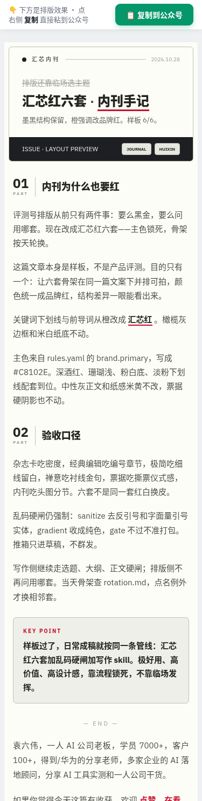

# 公众号百万级排版 Skill（gzh-million-layout-skill）

> 🔴 **作者：袁六伟 · 台州汇芯**｜一人 AI 公司创业者，学员 7000+，客户 100+，得到/华为分享老师  
> 📮 更多 AI 工具实测与自动化实战，关注 **公众号 / 视频号：袁六伟**

把公众号 Markdown 排成「像百万阅读账号」的 HTML：汇芯红 `#C8102E` 六套骨架按天轮换，带乱码硬闸、速查表真表格、长图横拼、文末业务介绍海报。

## 效果展示

| | |
|:---:|:---:|
|  |  |
| 周一 · 杂志卡 | 周二 · 经典编辑 |
|  |  |
| 周三 · 极简细线 | 周四 · 禅意留白 |
|  |  |
| 周五 · 票据 | 周六 · 内刊手记 |

## 安装

```bash
npx skills add sixwei2025/gzh-million-layout-skill
```

也可把 `skills/公众号百万级排版skill/` 整个文件夹拷进 agent 的 skills 目录（Claude Code / Codex / Cursor / WorkBuddy 等支持 `SKILL.md` 即可）。

## 依赖

- 任意支持 `SKILL.md` 的 Agent
- Python 3（跑 `scripts/gzh_design_sanitize.py`）
- 推草稿箱（可选）：自备 `WECHAT_APPID` / `WECHAT_SECRET`；**本仓库不含密钥与群发脚本**

## 快速开始

对 agent 说：

> 用「公众号百万级排版skill」，把这篇 Markdown 按今天的骨架排版，过乱码硬闸，文末挂海报，只出草稿预览。

## 目录

```
README.md
LICENSE
assets/showcase/                 # 六套预览图
skills/公众号百万级排版skill/
  SKILL.md
  author-bio.txt
  assets/poster-huixin-end.jpg
  themes/                        # 汇芯红六套
  references/
  scripts/
```

## 许可

MIT。账号、素材版权与第三方商标归各自权利人。

---

## 关于作者

**袁六伟 · 台州汇芯**：一人 AI 公司创业者。公众号 / 视频号：**袁六伟**。

这个 Skill 免费开源。有用的话欢迎 ⭐ Star，再关注「袁六伟」看更多实战。
